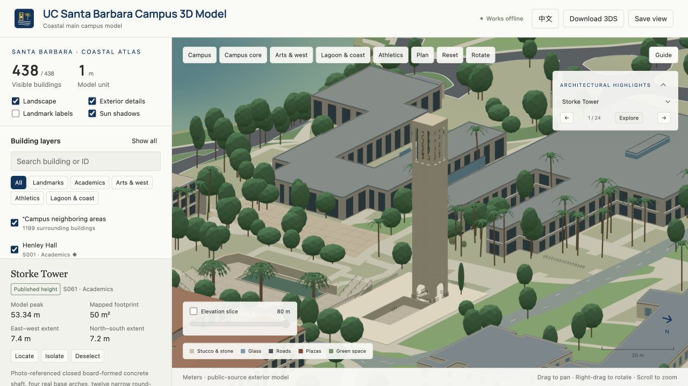

# Architectural Highlight form review

Reviewed 18 October 2026: all 24 building Highlights.

This audit records the individual massing, roof, entrance, facade and characteristic assemblies. A generic window-frame count is not evidence of architectural agreement. Official footprints and published heights remain distinct from photo-based estimates. Previously corrected presentation cameras and dedicated Alder/Suzzallo assemblies are preserved.

| Code | Highlight | Decision | Features reviewed | Reference |
|---|---|---|---|---|
| S001 | Henley Hall | reconstructed source-specific exterior | western laboratory bar; eastern three-storey oval open-air atrium; connected galleries and stair flights; north curtain glazing; south terracotta solar screen and projecting eaves | [Reference](https://kierantimberlake.com/work/henley-hall-institute-for-energy-efficiency/) |
| S008 | Campbell Hall | retained existing individual exterior after review | Circular lecture hall and lower service wing; Alternating radial folded-plate roof; Plaza-facing tall glazed lobby and attached mullions | [Reference](https://aait.ucsb.edu/event-av-services/campbell-hall/gallery) |
| S022 | Elings Hall (CNSI) | reconstructed source-specific exterior | three-storey main laboratory bar; separate low northern ancillary volumes; glazed northern lobby; inclined end feature wall; closely spaced attached facade members; no unrealized display | [Reference](https://www.mat.ucsb.edu/~g.legrady/academic/courses/09f200a/c/cnsi.html) |
| S030 | Kohn Hall | retained existing individual exterior after review | Low tile-roofed courtyard wings; Separate orange entrance tower; Open central court with supported partial awning | [Reference](https://www.kitp.ucsb.edu/news/new-kohn-hall) |
| S040 | UCSB Library | retained existing individual exterior after review | Original eight-storey library tower; Lower wings and new northern addition; Glazed Paseo and western entrance portal; Separate aerial-referenced roof finishes and PV patches | [Reference](https://www.library.ucsb.edu/visit/floor-plans-locations) |
| S042 | Harold Frank Hall | reconstructed source-specific exterior | five-storey classroom/research bar; lower courtyard/service wing; recessed southern glazed lobby; deep horizontal concrete shades; paired grouped windows and exposed concrete frame | [Reference](https://sp.dfss.ucsb.edu/entrances/enter-bldg/hfh.html) |
| S053 | Bren Hall | reconstructed source-specific exterior | open triangular courtyard; separate office and laboratory wings; set-back upper office level; courtyard balconies and supported shade canopy; limited roof-mounted photovoltaic rows | [Reference](https://bren.ucsb.edu/about/bren-hall) |
| S054 | Bioengineering | reconstructed source-specific exterior | three-storey concrete research wings; punched windows with deep square reveals; three-storey glazed entrance atrium; set-back clerestory strip; attached south window-zone shades | [Reference](https://bioengineering.ucsb.edu/facilities) |
| S061 | Storke Tower | retained existing individual exterior after review | Closed board-formed concrete shaft; Twelve actual belfry slots and four base arches; 61 recessed bronze bells; Sunken plaza, nine-bay media arcade, reflecting pool and connected stairs | [Reference](https://www.campuscalendar.ucsb.edu/storke_tower) |
| S063 | Interactive Learning Pavilion | retained existing individual exterior after review | Separated curved classroom volumes; Open-air terrace galleries; Joined stair flights and floor landings; Positive-depth slabs and parapets without duplicate coplanar caps | [Reference](https://lmnarchitects.com/project/classroom-building-university-of-california) |
| S065 | Marine Science Building | reconstructed source-specific exterior | three wings around open courtyard; four above-ground floors; basement excluded; second-level courtyard patio; sawtooth exterior bays; continuous concrete floor bands and shaded glazing | [Reference](https://msi.ucsb.edu/facilities-services/marine-science-research-building) |
| S066 | Music | reconstructed source-specific exterior | separate performance halls and teaching wings; two open courtyards; low clay roofs by individual wing; shaded courtyard circulation; Music Bowl stepped seating and stage | [Reference](https://music.ucsb.edu/operations/facilities) |
| S076 | University Center (UCEN) | retained existing individual exterior after review | Lower lagoon-facing rooms and set-back upper level; Glazed public frontage; Supported outdoor terrace and guardrails; Connected patio and lawn approach | [Reference](https://www.ucen.ucsb.edu/meet/meetings-events/outdoor-spaces) |
| S078 | Robertson Gym | retained existing individual exterior after review | Separate high gym hall and lower support wings; Recessed glazed entrance; Positive-depth roof edges and facade bays; Mapped adjoining athletic facilities retained | [Reference](https://recreation.ucsb.edu/facilities) |
| S084 | Events Center | retained existing individual exterior after review | Main arena separated from low entry and annex volumes; Broad structural roof enclosure; Glazed entrance bays and supported eaves; Mapped footprint and separate service circulation | [Reference](https://ucsbgauchos.com/facilities) |
| S086 | Humanities and Social Sciences Building | reconstructed source-specific exterior | six-storey northern office tower; four-storey west wing and curved east wing; curved-head end pavilions; real open ground-floor arcade; red diamond frieze and supported rooftop trellis | [Reference](https://marcuse.faculty.history.ucsb.edu/projects/HSSBLocation.htm) |
| S088 | Student Resource Building | reconstructed source-specific exterior | three-storey office and student-service wings; glazed central circulation/clerestory; low curved east meeting pavilion; supported entrance canopy; west-facing ventilation screen | [Reference](https://srb.sa.ucsb.edu/about) |
| S091 | Arts | reconstructed source-specific exterior | separate north and south arts wings; high-bay studio and two-storey classroom masses; open sculpture courtyards; glazed gallery fronts; roof monitors and shaded circulation | [Reference](https://arts.ucsb.edu/atrium/) |
| S095 | San Rafael Tower | reconstructed source-specific exterior | seven-storey courtyard tower; recessed paired residential bays; deep concrete vertical piers; solid horizontal slab bands; lower glazed arrival and entrance canopy | [Reference](https://www.housing.ucsb.edu/housing-options/options-filter/san-rafael) |
| S125 | University House | reconstructed source-specific exterior | low mapped residential wings; individual low-pitched clay roofs; deep garden eaves; courtyard veranda with grounded columns; glazed garden doors and chimney | [Reference](https://news.ucsb.edu/in-focus/uc-regents-approve-acquisition-campus-residential-property) |
| S130 | Benioff Ocean Science Laboratory | reconstructed source-specific exterior | low west laboratory bar and taller east coastal block; clay hipped roofs; continuous shaded sea-facing glazing; white concrete floor bands; recessed entrance and supported balcony | [Reference](https://news.ucsb.edu/2026/022864/ucsb-seeks-community-input-university-plans-sea-level-rise) |
| S151 | Harder Stadium | retained existing individual exterior after review | Narrow mapped grandstand footprint; Stepped bleacher rows; Field-facing seat edges; Grounded poles and supported upper guardrail | [Reference](https://ucsbgauchos.com/facilities/harder-stadium/1) |
| S166 | Recreation Center (Rec Cen) | retained existing individual exterior after review | Separate high activity halls and low entry wings; Double-height glazed gym frontage; Roof edges and floor bands; Pools, circulation and neighboring athletics kept separate | [Reference](https://recreation.ucsb.edu/facilities) |
| S173 | Mosher Alumni House | retained existing individual exterior after review | Three terraced alumni-house levels; Glazed meeting rooms and low garden wing; Open circular rooftop pergola with radial rafters; Supported deck, railings and Whalen Plaza approach | [Reference](https://www.alumni.ucsb.edu/about/mosher-house) |

Browser review uses the actual exported 3DS building layers at the presentation view and the opposite side; focused low-angle views check open structures. Geometry, terrain contact, lossless compression, offline bytes and presentation framing are separately checked. This is a public-source exterior study, not surveyed BIM.

## Local browser review

Run `npm run build:highlight-review`, serve the repository locally and open `tmp/highlight-review.html` for the six-building review grid. Add `?code=` followed by a code from the table for a focused full-source view. This development gallery does not apply runtime LOD or ship as part of the public map.
